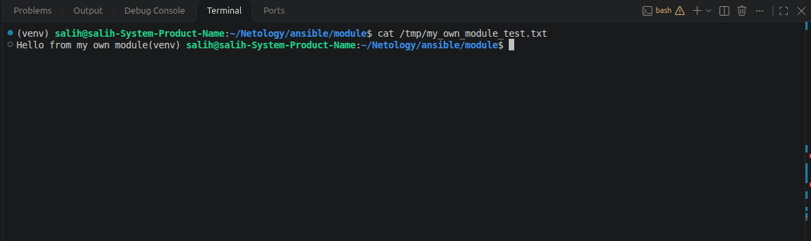
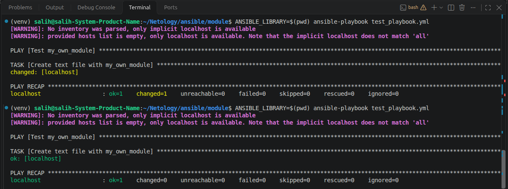
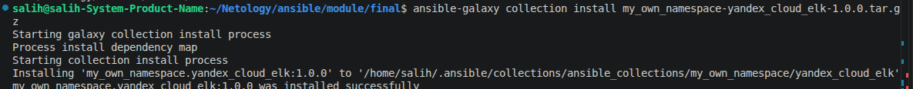
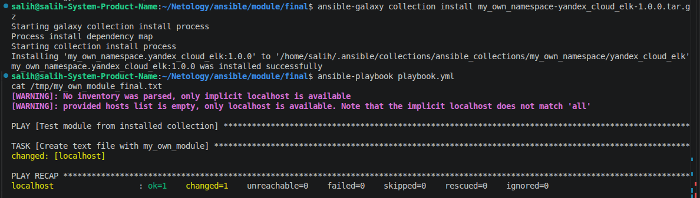

# my_own_namespace.yandex_cloud_elk

Учебная Ansible Collection (Netology, занятие «Создание собственных модулей»).

Содержит:

- **Модуль `my_own_module`** — создаёт текстовый файл на удалённом хосте по пути `path` с содержимым `content`. Идемпотентен: если файл существует с тем же содержимым, изменений не происходит (`changed=false`). Поддерживает check mode.
- **Роль `my_own_role`** — обёртка над модулем, все параметры имеют значения по умолчанию.

## Установка

Из собранного архива:

```bash
ansible-galaxy collection install my_own_namespace-yandex_cloud_elk-1.0.0.tar.gz
```

## Модуль my_own_module

### Параметры

| Параметр | Тип | Обязательный | Описание |
|---|---|---|---|
| `path` | str | да | Абсолютный путь создаваемого файла |
| `content` | str | да | Содержимое файла |

### Возвращаемые значения

| Поле | Описание |
|---|---|
| `path` | Путь файла |
| `message` | Результат выполнения |
| `changed` | Были ли внесены изменения |

### Пример

```yaml
- name: Create text file
  my_own_namespace.yandex_cloud_elk.my_own_module:
    path: /tmp/my_file.txt
    content: "Hello world"
```

## Роль my_own_role

### Переменные (defaults/main.yml)

| Переменная | Значение по умолчанию | Описание |
|---|---|---|
| `my_own_module_path` | `/tmp/my_own_module.txt` | Путь файла (параметр `path` модуля) |
| `my_own_module_content` | `Hello from my_own_role` | Содержимое (параметр `content` модуля) |

### Пример playbook

```yaml
- name: Use my_own_role
  hosts: localhost
  roles:
    - role: my_own_namespace.yandex_cloud_elk.my_own_role
      vars:
        my_own_module_path: /tmp/custom.txt
        my_own_module_content: "Custom content"
```

## Сборка

```bash
ansible-galaxy collection build
# получится my_own_namespace-yandex_cloud_elk-1.0.0.tar.gz
```

## Скриншоты




